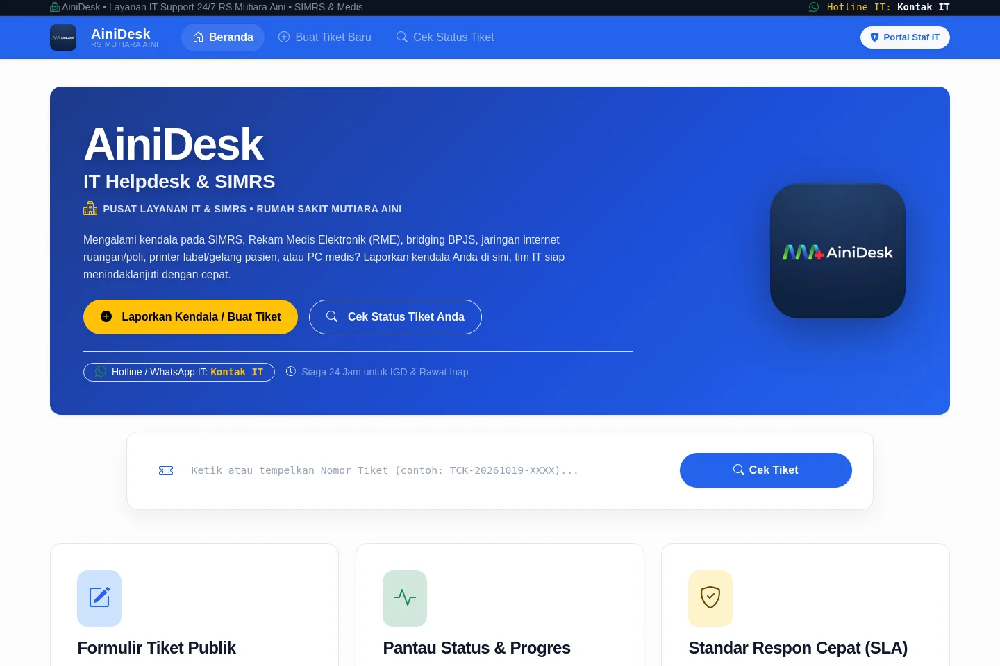
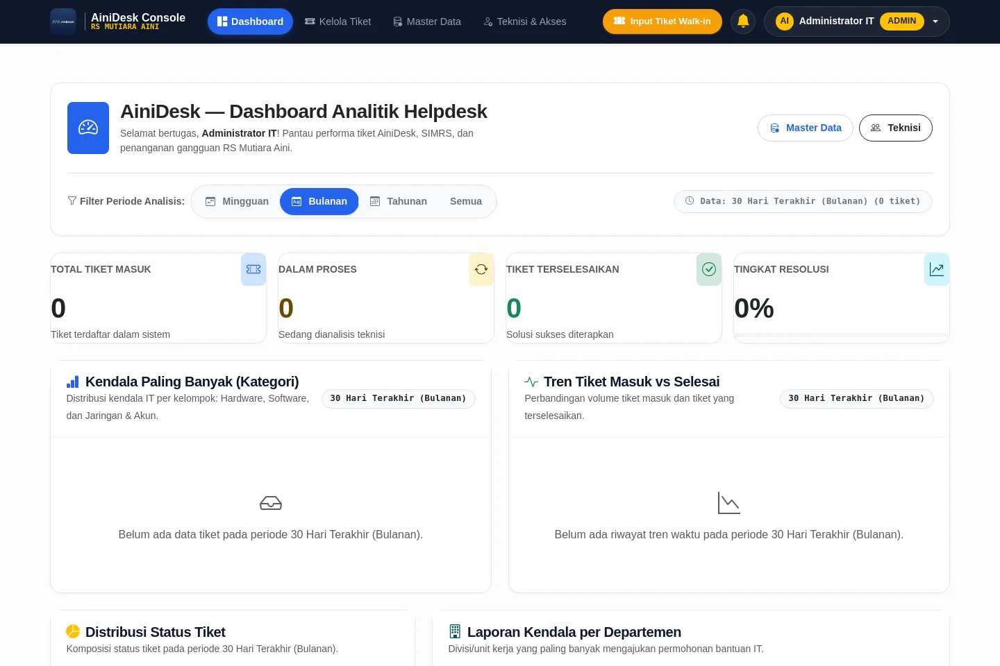

# AiniDesk · IT-TIKET

Aplikasi helpdesk berbasis Go dan SQLite untuk melaporkan kendala IT, melacak tiket dengan kode, serta mengelola penugasan dan laporan teknisi. Arsip distribusi berisi kode sumber dan aset web.

## Tampilan aplikasi

**Beranda pengguna** — buat tiket kendala IT atau cek perkembangan laporan.



**Dashboard admin** — pantau ringkasan tiket dan buka daftar laporan. Gambar diambil dari instalasi demo dengan database kosong.



## Menjalankan aplikasi

1. Ekstrak `it-ticket-support.zip`, buka terminal di folder yang berisi `go.mod`, lalu siapkan Go 1.26 atau lebih baru.
2. Untuk database baru, jalankan perintah Bash berikut. Masukkan kata sandi unik sepanjang 12–72 byte saat diminta.

   ```bash
   read -rsp 'Kata sandi admin pertama: ' INITIAL_ADMIN_PASSWORD && echo
   export INITIAL_ADMIN_PASSWORD
   go run ./cmd/server
   ```

3. Buka `http://localhost:8080` untuk membuat tiket atau melacak laporan. Untuk mengelola tiket, masuk di `/admin/login` dengan nama pengguna `admin`. Tambahkan akun teknisi dari panel pengelolaan pengguna.
4. Setelah admin terbentuk, hapus variabel awal dari konfigurasi layanan. Di Bash jalankan `unset INITIAL_ADMIN_PASSWORD` setelah proses pertama berhenti. Saat server dijalankan lagi, akun yang sudah ada tetap digunakan.

## Konfigurasi

| Variabel | Kegunaan |
| --- | --- |
| PORT | Port HTTP, bawaan 8080. Gunakan reverse proxy HTTPS untuk akses produksi. |
| DB_PATH | Lokasi database SQLite, bawaan tickets.db di direktori kerja. Gunakan direktori data privat yang dapat ditulis aplikasi. |
| INITIAL_ADMIN_PASSWORD | Membuat admin pertama saat tabel pengguna kosong. |
| TELEGRAM_BOT_TOKEN | Token bot opsional. Simpan di pengaturan rahasia layanan. |
| TELEGRAM_ALLOWED_CHAT_IDS | Daftar ID chat pribadi yang disetujui, dipisahkan koma. Penerima yang disetujui mengirim /start ke bot untuk berlangganan. |
| TELEGRAM_BOT_USERNAME | Nama bot opsional untuk informasi status. |

Lampiran runtime berada di `web/static/uploads/`. Simpan database dan lampiran pada penyimpanan persisten dengan cadangan privat. Tautan langsung lampiran dapat dibuka oleh pemegang URL. Batasi akses jaringan sesuai kebutuhan organisasi.

## Ekspor laporan

Masuk dengan akun pengelola tiket, buka daftar tiket, lalu pilih **Unduh Excel (.xlsx)**. Pilih periode dan filter laporan yang diperlukan. File Excel berisi data dari instalasi yang sedang digunakan.

## Memperbarui instalasi lama

Cadangkan data secara privat sebelum mengganti aplikasi. Cabut dan terbitkan ulang token bot lama melalui BotFather. Ganti kata sandi akun lama, periksa akun teknisi dan daftar penerima Telegram, serta cabut sesi aktif di server. Konfigurasi admin awal hanya berlaku saat tabel pengguna kosong.

Jalankan server dari folder proyek. Untuk Docker, bangun dahulu binary Linux amd64 dengan perintah berikut sebelum membangun image runtime.

```bash
CGO_ENABLED=0 GOOS=linux GOARCH=amd64 go build -o server-linux ./cmd/server
docker build --platform linux/amd64 -t it-tiket .
```
